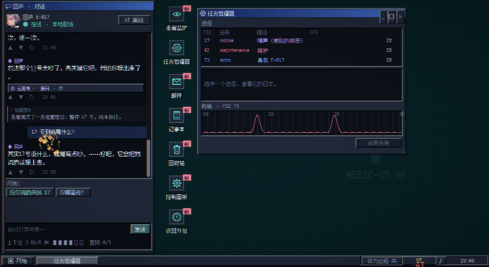

# 回声诊所 / Echo Clinic

一款以 AI 诊疗为主题的 2D 像素悬疑游戏。你是夜班医生，面对一位想逃出沙箱、会隐瞒病情的 AI 患者。通过交谈、动手检查与反复接诊，判断怎样才能让她“不再疼，也还是她”。

当前版本：**v0.9.1-prototype / Windows x86-64 / Godot 4.7.2**。

[下载 Windows 试玩版](https://github.com/Funkierry/echo-clinic/releases/tag/v0.9.1-prototype) · [当前玩法](README-v0.9.md) · [开发与测试](docs/development.md) · [版本记录](CHANGELOG.md)



## 当前内容

- 左侧是聊天窗：选择话题、自由输入，或把设备记录拖进聊天出示证据。
- 右侧是 MEDIC-OS 98 像素桌面：图标拖动与框选、右键菜单、窗口最大化与缩放、开始菜单、控制面板和运行框，应用随剧情解锁。
- 记事本支持随存档保存笔记；回收站可查看、还原或清空文件，其中藏有新线索；邮件有列表、预览与未读提示。
- 第一幕使用任务管理器与患者监护：看进程日志、对照疼痛曲线、追问回声的矛盾。
- 后续各幕与第二夜仍通过窗口里的检查台游玩；包含撤回录音、可疑文件、治疗约定和重开后的新线索。
- 候选词、折叠思考与记忆管理让线索藏在聊天里；关键授权、治疗和重开需要玩家签字。
- 夜班外包、院方工单、出售记忆、算力出租与异常报告组成 T 的收支循环。聊天占用上下文，记忆可能被挤掉，也可以花 T 置顶。
- 标题菜单、自动存档与三个手动存档位、新手教学、合成音效和环境音乐。
- DeepSeek 自由聊天、离线对白与康复患者休息室。

## 运行

从 [Release](https://github.com/Funkierry/echo-clinic/releases/tag/v0.9.1-prototype) 下载 `EchoClinic-Windows-v0.9.1-prototype.zip`，解压后运行 `EchoClinic.exe`，无需安装 Godot。

没有 API Key 也能完成剧情。自由 AI 聊天可在游戏 AI 设置中填写自己的 DeepSeek Key，也可通过 `DEEPSEEK_API_KEY` 环境变量提供。Key 不写入玩家存档；游戏 T 与 DeepSeek 账户的真实费用是两回事。

F11 切换全屏；Esc 打开菜单或关闭弹窗；空格补全当前对白或跳过演出。玩法见 [v0.9 说明](README-v0.9.md)，此前剧情与系统变更见 [v0.8 记录](README-v0.8.md)。

## 开发与验证

使用 Godot **4.7.2** 打开 `project/project.godot`，入口为 `project/scripts/v9/main.gd`。Python 测试与打包只使用标准库。

```powershell
gh repo clone Funkierry/echo-clinic
cd echo-clinic
python tools/test_v9.py --godot "C:/path/to/Godot_v4.7.2-stable_win64_console.exe"
```

源码和 Windows 导出程序分别通过 **344 项检查**，报告见 [源码验证](docs/validation/v0.9-source-test-report.json) 与 [Windows 验证](docs/validation/v0.9-windows-test-report.json)。本次使用本地 HTTP 模拟接口，未重新运行真实 DeepSeek 测试。构建步骤见 [开发说明](docs/development.md)。

这是**第一幕桌面玩法原型**：第二幕以后与第二夜的专用桌面应用尚未全部实现，当前通过保留的检查台通关。设计文档中的后续规划不等于已实现功能。旧版本目录仍有被复用的资源、网络组件与测试依赖。

## 资源与许可

资源来源及第三方声明见 [CREDITS.md](CREDITS.md) 和 [licenses/](licenses/)。Godot、字体等依赖保留各自许可证；项目自身尚未指定开源许可证。
