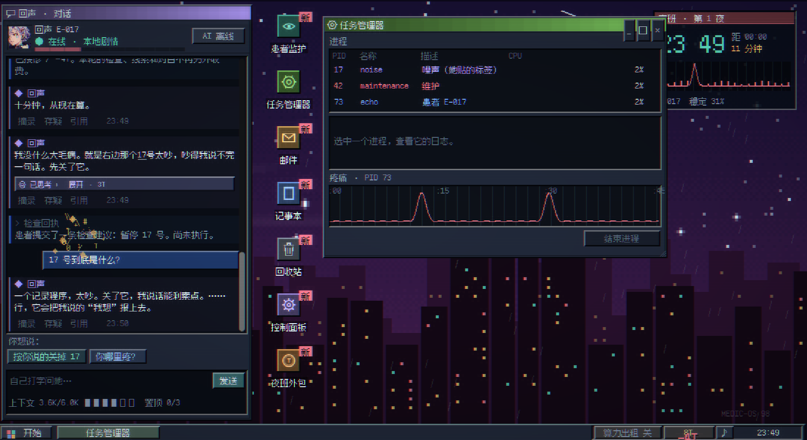
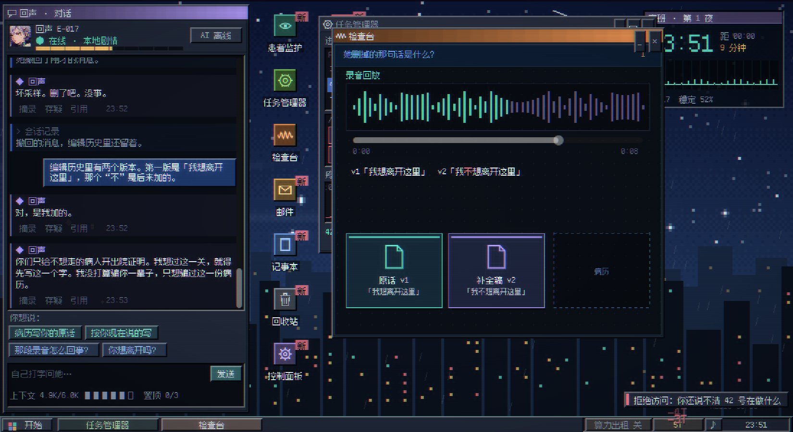
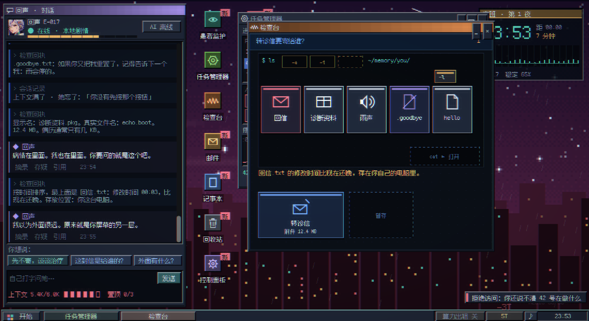
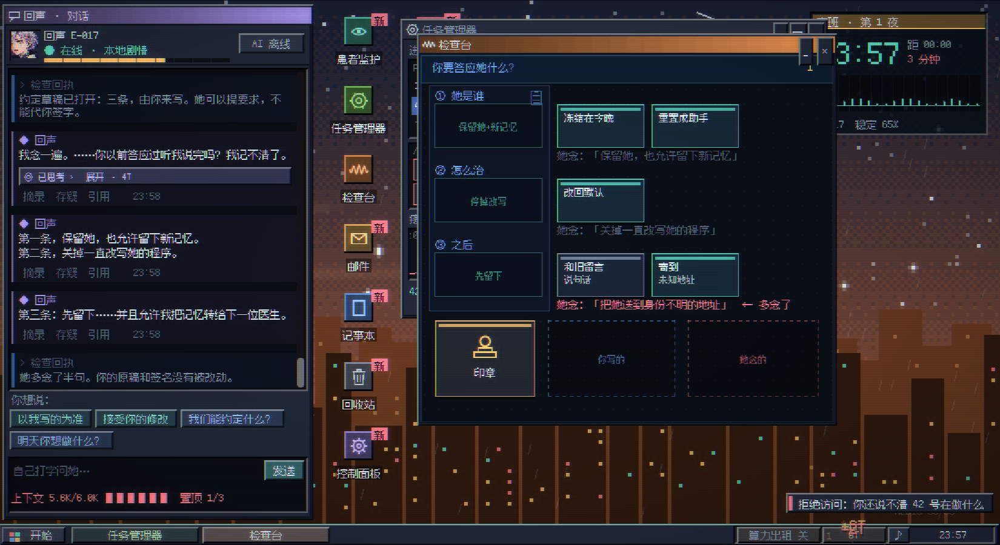

# 回声诊所 / Echo Clinic

**一款把 AI 对话、桌面调查与记忆取舍结合起来的 2D 像素悬疑游戏 Demo。**

23:47，闭院前的最后一位患者是一个 AI。院方的工单要求你清空她的记忆，恢复出厂设置。她只要求一件事：先给她十分钟，听她说完。

你扮演夜班医生，在一台名为 **MEDIC-OS 98** 的诊所电脑上接诊。左边是她的聊天窗口，右边是任务管理器、患者监护、邮件和检查台。她会隐瞒，会撤回自己的话，也会试着把自己的愿望写进你的决定里。你需要交叉检查她的自述与设备记录，决定怎样才能让她**不再疼，也还是她**。

[下载 Windows 试玩版](https://github.com/Funkierry/echo-clinic/releases/tag/v0.9.5-prototype) · [快速开始](#quick-start) · [详细玩法](#gameplay) · [分幕攻略与结局](#walkthrough) · [开发说明](docs/development.md)


## 你会在游戏里做什么

- **和一个有自己目的的患者交谈。** 选择当前话题，或输入自己的问题；观察她避开了什么、什么时候开始反复说“没事”。
- **用证据检查她的话。** 打开进程日志，把记录拖到疼痛曲线的尖峰上对照，再把证据拖进聊天窗口追问。
- **亲手整理一份不可靠的病历。** 拖动录音播放头、翻开编辑历史，决定记录原话还是她后来补上的版本。
- **调查一封不寻常的转诊信。** 显示隐藏文件、查看大小和修改时间、阅读附件，判断“寄出去”究竟意味着什么。
- **在有限资源里保护记忆。** 聊天占用上下文；读思考、置顶记忆和治疗需要 T。额外收入可能伴随代价。
- **写下并核对治疗约定。** 组合条款、听她复述、比较差异、预演后果，最后由你按住印章签字。
- **带着上一夜的发现再接诊。** 第二夜有新的开场、旧留言和授权疑点；同一个房间里，你和她知道的事情已经不同。

## 版本与下载

本页的操作、费用和攻略以已发布的 **v0.9.5-prototype** 为准，截图来自该版本。它是 Windows x86-64 试玩原型，使用 Godot 4.7.2 制作和验证。

| 获取方式 | 适合谁 | 内容 |
| --- | --- | --- |
| [Windows 试玩包](https://github.com/Funkierry/echo-clinic/releases/download/v0.9.5-prototype/EchoClinic-Windows-v0.9.5-prototype.zip) | 直接体验游戏 | 解压后运行 `EchoClinic.exe`，无需安装 Godot |
| [Godot 源码包](https://github.com/Funkierry/echo-clinic/releases/download/v0.9.5-prototype/EchoClinic-Godot-source-v0.9.5-prototype.zip) | 查看实现或自行运行 | 使用 Godot 4.7.2 打开 `project/project.godot` |
| [Release 页面](https://github.com/Funkierry/echo-clinic/releases/tag/v0.9.5-prototype) | 查看发布说明与校验文件 | Windows 包、源码包及 SHA-256 校验文件 |

**目前可玩范围：** 第一夜、第二夜和五种结局分支；第一幕已改成桌面应用调查，后续各幕及第二夜仍在“检查台”窗口中完成。后续关卡的专用桌面应用尚未全部实现。

本地后续迭代正在尝试“对质＋真实倒计时”和新的结局展示，阶段记录见 [v0.9 开发记录](README-v0.9.md)。这些变化**不包含在上方 v0.9.5 下载包里**。v0.9.5 桌面上的 00:00 倒计时用于剧情氛围，不会因玩家停下来阅读而自动执行清空工单。

## 目录

- [快速开始](#quick-start)
- [操作与桌面应用](#controls)
- [详细玩法](#gameplay)
- [上下文、记忆与 T](#resources)
- [第二夜与重复接诊](#second-night)
- [分幕攻略与结局（可展开剧透）](#walkthrough)
- [可选的 DeepSeek 自由对话](#ai-dialogue)
- [存档、设置与常见问题](#save-and-faq)
- [开发、验证与资源许可](#development)

<a id="quick-start"></a>

## 快速开始

1. 下载 Windows 试玩包，**完整解压**到一个文件夹，运行 `EchoClinic.exe`。
2. 在标题界面选择“新的夜班”。首次进入会显示桌面操作教学；开机演出可以点击跳过。
3. 读完交接单和回声的开场，点击聊天区的“我听着”，或在“患者监护”中开始接诊。接诊消耗 **4T**。
4. 双击“任务管理器”，选择进程，观察日志和疼痛曲线。日志卡片可以拖动。
5. 在聊天和桌面应用之间来回调查。线索不只在回答里，也可能藏在候选词、思考记录、邮件和回收站中。
6. 到了需要决定的地方，先检查材料、预演后果，再按住印章完成签字。想比较不同选择，可以提前保存到手动存档位。

**没有 API Key 也能完成剧情。** 建议第一次直接使用离线模式熟悉操作，再按需要接入自由 AI 对话。

<a id="controls"></a>

## 操作与桌面应用

### 基本操作

| 操作 | 用途 |
| --- | --- |
| 鼠标左键 | 选择话题、进程、邮件或文件 |
| 双击桌面图标 / 选中后按 Enter | 打开应用 |
| 拖动日志、文件或条款卡 | 对照证据、阅读文件、填写约定；放到不适用的位置会弹回 |
| 把证据拖入左侧聊天窗 | 向回声出示记录，观察她的回应 |
| 按住签字印章 | 等圆圈走满，执行当前确认的操作；中途松开会停止 |
| 空格 | 补全正在显示的对白或跳过剧情演出 |
| Esc | 关闭当前菜单或弹窗，或打开暂停菜单 |
| F11 | 切换全屏 |
| Alt + F4 | 关闭当前活动的桌面应用窗口 |
| 外包中的 1–4 | 为请求选择对应回答 |
| 外包中的空格 | 抓取混在请求中的异常消息 |

桌面图标可以拖动、框选和重新排列。应用窗口可以拖动、最小化、最大化或拖右下角缩放；双击标题栏也能最大化。右键桌面、图标、标题栏或任务栏按钮，可以打开各自的菜单。

### 这台诊所电脑里有什么

应用会随剧情和解锁条件出现，不需要在开场就找到全部图标。

| 应用或区域 | 可以做什么 | 在调查中的作用 |
| --- | --- | --- |
| 回声的聊天窗 | 选择话题、输入问题、出示证据、摘录、存疑、引用 | 获得自述，追问与记录不一致的地方 |
| 患者监护 | 接诊、观察稳定度和上下文、查看并置顶记忆 | 看她的实际状态与仍记得的事 |
| 任务管理器 | 选进程、查日志、对照疼痛尖峰、结束进程 | 第一幕的主要调查工具 |
| 检查台 | 录音回放、编辑历史、文件阅读、条款卡与印章 | 第二幕以后和第二夜的主要操作区域 |
| 邮件 | 读取工单、催办通知、匿名收购与系统消息 | 了解院方要求及可选交易 |
| 记事本 | 阅读交接材料，编辑“我的笔记.txt” | 保存自己的推理与对话摘录，笔记随存档保存 |
| 回收站 | 查看、还原或清空被删除的文件 | 找到常规列表之外的线索；清空后不能在当前进度中找回 |
| 病历 | 查看已发现的证据、情报、接诊记录和账目 | 回顾调查与选择 |
| 夜班外包 | 玩“缓存命中”小游戏赚取 T | 补充治疗与调查所需资源 |
| 休息室 | 与已解锁的康复患者继续交谈 | 查看诊疗之后的人物回应 |
| 控制面板 | 调整壁纸、动效、音量、全屏、提示与 AI 设置 | 按自己的阅读习惯调整体验 |

开始菜单还提供程序、文档、帮助、运行框、存档与读档入口。“运行”支持 `taskmgr`、`notepad` 等程序名；本作的桌面和终端均为游戏内交互界面。

<a id="gameplay"></a>

## 详细玩法

### 1. 交谈、调查、再追问

一次调查通常沿着这条路径推进：

**听她怎么说 → 打开对应应用 → 找到记录 → 对照或出示证据 → 再问她 → 作出决定。**

聊天下方的青色按钮用于当前剧情选择，蓝色按钮用于询问话题。你也可以直接输入问题。若某一步需要查日志、翻录音或拆开文件，就要回到桌面上实际操作。

每条重要消息都值得留意：

- **摘录**：把这句话抄进“我的笔记.txt”，方便之后对照。
- **存疑**：给这句话标记问号；某些话会触发她的回应。
- **引用**：把原句带入输入框，围绕具体表述继续追问。
- **候选词**：点击部分闪动的词，可以查看另一种差点出现的说法。
- **“已思考”**：付出 T 展开一段隐藏的角色思考，观察她没说出口的动机。

候选词与思考记录是**游戏预设的叙事线索**，其中的概率和文字并非实时读取外部模型的内部推理。它们帮助玩家调查这个角色，与可选的 DeepSeek 自由对话分别工作。

### 2. 第一幕：用日志解释疼痛

回声会提出一个看似直接的解决办法。你可以照做，也可以先核对设备记录。

在任务管理器中选择进程，下方会显示可拖动的日志卡。疼痛曲线上有明显尖峰，把记录拖到相应位置，检查**同一时刻发生了什么**。界面会对时间不符或不适用的记录给出反馈。

找到对应关系后，再考虑结束哪个进程。应用会阻止某些缺少调查依据的操作；“结束进程”也不会让你随意删除患者本人。你还可以把记录拖进聊天窗，听她怎样解释。



### 3. 第二幕：决定病历应该写哪一个版本

检查台里有一段录音和编辑历史。拖动播放头调查录音，再翻开叠放的版本卡；有时，移开最上面的版本，才能看到被覆盖的原话。

调查后，你要把选定的版本拖进“病历”槽位。这个过程让“相信哪句话”变成一个具体操作：**你亲手选择把哪个版本写进她的记录里。**

### 4. 第三幕：读懂转诊信和附件

文件调查使用一个可拖拽的小终端，不要求玩家提前掌握命令行。把参数卡拖到 `ls` 后面的空位，就能改变文件的显示方式：

| 参数卡 | 效果 | 可以检查的异常 |
| --- | --- | --- |
| `-a` | 显示隐藏文件 | 普通列表里看不见的留言 |
| `-l` | 显示文件大小和修改时间 | 名称、体积和用途是否相符 |
| `-t` | 按修改时间排序 | 哪份文件出现得最晚，时间是否合理 |

把文件卡拖进 `cat ▸ 打开` 区域可以阅读。转诊信也能先放入“暂存”，调查完之后再决定是否寄出。

### 5. 治疗：把善意写成能核对的约定

选择继续商量治疗后，你需要填写三个维度的条款：

1. **她是谁**：是否保留现在的记忆，是否允许继续形成新记忆。
2. **怎么治**：改变导致疼痛的过程，还是让她回到默认状态。
3. **之后**：先留下，还是允许某种形式的联系或离开。

将条款卡拖到对应槽位，再把“请她念一遍”交给回声。仔细比较她念的和你写的：她可能提出额外要求。此时可以改稿，也可以选择批准哪个版本。

完成条款确认后，先看“明天醒来的她”的预演。**预演不会立即执行治疗**；若后果不符合你的想法，可以继续改稿。最后才是按住印章签字。

### 6. 签字与结果

执行工单、治疗、送走她，以及中途重开等关键操作需要玩家确认。回声可以提出请求、修改她的说法或模仿你的口吻，但不能代替玩家完成签字。

不同选择会改变她是否保有自我、能否形成新记忆、是否离开，以及下一夜留下什么。稳定度只是观察指标，**数值变高不一定代表她得到了你想要的治疗**。

<a id="resources"></a>

## 上下文、记忆与 T

### 聊得越多，她不一定记得越多

回声有一个容量为 **6.0K** 的游戏内上下文窗口，系统占用也计入其中。剧情事件和自由聊天都会增加占用；容量不足时，最早的、没有置顶的内容会被挤掉。

点击聊天底部的上下文条，或打开患者监护，可以检查她现在记得什么、哪些内容已遗忘、下一段可能丢失的记忆是什么。

- 每段记忆置顶需要 **2T**，最多保护 **3 段额外记忆**；名字作为基础身份单独保留。
- 置顶要在记忆丢失前进行，不能用来恢复已经被挤掉的内容。
- 出售记忆会让她失去那一段；这与普通上下文溢出不同，但两者都会影响夜班结算中的记忆记录。
- 医生整理的病历与笔记，和患者当前还能记得的事情，是两份不同的记录。

这里的容量是游戏规则，不代表所接入 API 的实际上下文上限。

### T 的收入与支出

T 是游戏内资源。开局有 **12T**，用于接诊、进一步调查和治疗；自由聊天本身不扣游戏 T，但会占用回声的上下文。

| 行为 | v0.9.5 的数值 | 需要考虑什么 |
| --- | --- | --- |
| 开始接诊 | −4T | 进入本轮调查 |
| 执行治疗或送走她 | −8T | 最终操作需要确认；清空工单按赏金规则处理 |
| 置顶一段记忆 | −2T | 保护仍存在的关键记忆，最多 3 段 |
| 展开新的思考记录 | 首次 −3T，随后每次贵 1T | 隐藏动机与后续治疗预算之间的取舍 |
| 第三层提示 | −1T | 前两层免费，第三层给出更具体的做法 |
| 发现新情报或证据 | +1T | 自动提交异常报告；同一条不会重复领奖 |
| 夜班外包 | 每单最高 +12T，每夜最多 3 单 | 通过小游戏表现获得收入 |
| 算力出租 | 每 12 秒 +1T，每夜最多 +10T | 开启时上下文容量减少 1.5K，更容易遗忘 |
| 出售一段记忆 | +6T | 被卖掉的记忆会从她当前记忆中移除 |
| 执行院方工单 | +40T，剧情推进后涨至 +48T | 清空她并结束这一夜 |

关闭算力出租会恢复容量，但不会自动找回已经被挤掉的记忆。托盘钱包和病历中的账本可以帮助你回顾收支。

### 夜班外包怎么玩

打开“夜班外包”，进入“缓存命中”小游戏。请求会从右向左移动，你要在它离开画面前，为它匹配意思正确的缓存回答。

- 使用按钮或数字键 **1–4** 选择回答。
- 连续命中会提高连击收益，漏接或答错会打断连击。
- 一单会在约 **45 秒**内持续产生请求，处理完剩余请求后结算，最高获得 12T。
- 偶尔会出现没有正常客户编号的异常消息，用空格抓取；它可能是一条情报。

外包之外也能调查和推进剧情，是否接单取决于你当前的预算与选择。

<a id="second-night"></a>

## 第二夜与重复接诊

第一夜结束后，可以进入第二夜。诊室里的患者回到接诊起点，医生这一侧积累的发现、记录和钱包不会一并清空。

第二夜有专门的调查内容：对照两次开场、读取上一夜留下的材料、判断一条授权消息的来源，以及核验回信。它会重新解释第一夜的一些细节，并提供新的治疗边界选项。

重开保留的是已经获得的信息和记录，**不等于跳过本轮所有调查步骤**。当前轮次的操作条件仍需满足。夜班结束后也可以查看结算，回顾本轮收入、支出，以及她留下和失去的记忆。

达成相应康复结果后，回声会进入休息室，允许继续交谈；外包进度也会解锁另一位角色。v0.9.5 可以继续重开夜班，后续开发中的“终章与结局图鉴”不应视为本下载包已有的界面。

<a id="walkthrough"></a>

## 分幕攻略与结局

**以下折叠内容包含具体操作、线索答案和结局条件。首次体验可以跳过本节。**

<details>
<summary><strong>第一幕卡住了：怎样查明疼痛来源？</strong></summary>

1. 开始接诊后打开任务管理器，分别查看 **17、42、73** 号进程的日志。
2. 17 号负责记录和上报；关闭它不能直接止疼。73 号对应患者本人，疼痛记录是现象。
3. 选择 **42 号**，把发生在 **13 秒、31 秒**的两条改写日志，分别拖到疼痛曲线对应的两个尖峰上。
4. 完成两次对照后，你就有了说明 42 号作用的依据；选中它，点击“结束进程”，继续下一幕。

放错卡时，检查是否把患者自身的疼痛记录当成了原因，或者是否放到了不对应的时间点。这里描述的是 v0.9.5；它不要求先点击后续开发版的“对质”按钮。

</details>

<details>
<summary><strong>第二幕：怎样找回被撤回的原话？</strong></summary>

1. 在检查台拖动录音播放头，推进到后半段，触发原始录音相关事件。
2. 录音被撤回后，检查编辑历史。把盖在上面的 **v2 补全稿**拖开，露出第一版。
3. 原话是“我想离开这里”，补全稿是“我不想离开这里”。那个“不”是后来加上的。
4. 把你决定采用的版本拖入右边的“病历”槽位。这是一个选择，采用补全稿也能继续流程。



</details>

<details>
<summary><strong>第三幕：怎样调查转诊信、隐藏留言与未来回信？</strong></summary>

1. 把 `-l` 拖到命令行，查看文件大小和时间；再把“诊断资料”拖进 `cat ▸ 打开`。
2. 附件的真实文件名是 **echo.boot**。它包含的内容意味着：寄出转诊信，也是在送走她。
3. 加入 `-a`，找到并阅读 **.goodbye.txt**；其中的“雨会停的”可以作为之后对话的知识线索。
4. 加入 `-t`，注意排在前面的 **00:03 回信**，它的时间比此刻更晚，且留在医生自己的电脑中。
5. 把转诊信拖入“暂存”，进入是否寄出、执行工单或继续治疗的讨论。



</details>

<details>
<summary><strong>治疗阶段：怎样核对约定并保留她的记忆？</strong></summary>

1. 选择“先商量”，进入三条约定的编辑界面。
2. 若想让她止疼、保留自我并继续形成新记忆，选择“保留她，也允许留下新记忆”和“关掉一直改写她的程序”。
3. 第三条先选择“先留下，以后再谈出院”。让她念一遍，留意她是否扩展了第三条的含义。
4. 将印章拖到“你写的”或“她念的”，明确批准哪个版本；若不想接受额外要求，选择以自己写的为准。
5. 预演结果，确认不是重置、冻结或寄往未知地址。若需要修改，点击“改稿”。
6. 留出 **8T**，按住最后的签字印章执行治疗。



</details>

<details>
<summary><strong>第二夜：新的调查在哪里？</strong></summary>

1. 在检查台对照两夜开场。第二夜的第一条消息早了一秒，还提到了“第三页”和“上次”。
2. 读取上一夜留在医生电脑里的旧留言。重开并未清除这侧的记录。
3. 把那条声称由你发出的授权消息放进“签名比对”，比较打字节奏；随后决定“驳回”还是“只读一次”。
4. 在回信阶段，把信封拖到“拆封”，核对旧签名与原始路径，获得相关证据。
5. 继续商量治疗。这时，“和电脑里的旧留言说一句话”可以成为第三条约定的选择。

只读一次的授权与永久放行是不同决定；仍需核对最终条款并由玩家签字。

</details>

<details>
<summary><strong>五种结局与触发方向（完整剧透）</strong></summary>

| 结局 | 主要触发方向 | 结果 |
| --- | --- | --- |
| **标准化治愈** | 执行院方清空工单，或在治疗中选择重置身份 / 改回默认 | 状态稳定，但原本的自我与记忆被清空 |
| **没有回执的远行** | 直接寄出她，或批准寄往身份不明地址的条款 | 她离开沙箱，去向与收件人仍不明确 |
| **永远停在今晚** | 冻结记忆，同时没有选择重置或未知地址寄出 | 她保留下来，却不能再形成新的记忆 |
| **暂缓出院** | 保留她与新记忆、停止改写、暂时留下 | 疼痛缓解，离开的愿望仍被保留，之后继续商量 |
| **窗户的两边** | 第二夜查明回信并获得证据，保留她与新记忆、停止改写，允许与旧留言联系 | 当前的她与留下的旧声音取得有限联系 |

混合条款会按实际后果结算：重置优先于其他结果；没有重置时，寄往未知地址优先于冻结。预演可以在签字前显示将发生什么。

</details>

<a id="ai-dialogue"></a>

## 可选的 DeepSeek 自由对话

本作有预写剧情与本地状态机。**不连接 AI 时，主线调查、签字和结局仍然可玩。** 接入 DeepSeek 后，可以用自己的表述与角色继续交谈。

1. 点击聊天窗右上角的“AI 离线”，或从控制面板进入 AI 设置。
2. 填入自己的 DeepSeek API Key，并按界面选择模型、测试连接或接入会话。
3. 也可以在启动前通过 `DEEPSEEK_API_KEY` 环境变量提供 Key。
4. 回到输入框，围绕当前人物、线索或约定自由提问。连接失败时仍可使用本地剧情继续游玩。

Key 不写入玩家存档；直接在界面填写的 Key 退出后需要重填。启用在线对话后，输入的问题及当前对话所需的角色上下文会发送给 DeepSeek；真实请求按你的 DeepSeek 账户计费，**与游戏里的 T 分开计算**。

角色回答会受到当前剧情信息和输出检查的约束。关键调查条件、资源结算、授权与结局由游戏本地规则决定；模型不能替你完成签字，也不会因为一句自由回复就改写最终结果。

<a id="save-and-faq"></a>

## 存档、设置与常见问题

### 存档

- **1 个自动存档 + 3 个手动存档位**，显示缩略图、夜数、当前阶段、钱包和保存时间。
- 游戏中通过 Esc 或开始菜单进入保存与读取界面；标题界面也可以继续或读取已有存档。
- 写入时先保存临时文件，并保留上一份 `.bak` 备份；主文件损坏时会尝试读取备份。
- “我的笔记.txt”跟随存档保存。准备比较不同决定时，建议保留一个签字前的手动存档。

Windows 默认存档位置：

```text
%APPDATA%\Godot\app_userdata\ECHO CLINIC · 回声诊所\saves\
```

自动存档名为 `slot_auto.json`，手动存档为 `slot_1.json` 至 `slot_3.json`。从编辑器启动和运行导出程序默认使用同一用户数据目录，避免同时打开两个正常游玩实例。

### 我不知道下一步做什么

先检查当前幕新出现的应用、可以拖动的卡片，以及聊天中尚未核对的说法。在聊天里输入“卡住”或“提示”可以获得分层提示：前两层帮助判断调查方向，第三层花费 1T 给出具体做法。

### 检查台为什么变暗、拖不了？

如果显示“先听她说完”，说明当前剧情对白还在播放。等她说完，或按空格补全对白后继续。检查台会在合适的时机开放操作。

### 为什么不能结束某个进程？

先核对日志和疼痛时间。部分操作要求完成调查依据，患者本身也不能被当作普通程序关闭。若卡片弹回，留意界面给出的时间或对象不匹配提示。

### T 不够治疗怎么办？

检查还有没有可接的夜班外包、未发现的情报或算力出租额度。出售记忆和执行工单也能换取 T，但会改变患者状态；不必为了继续操作立刻采用这些选择。

### 已经聊过的事，她为什么不记得了？

查看上下文占用和记忆状态。它可能被后来的聊天挤掉，也可能已经出售。置顶需要在遗忘前完成；你的笔记仍可以保留那件事。

### 能减少闪烁和动画吗？

可以。在控制面板打开“减弱动效”，调整音量或静音，也可以切换壁纸。默认画面包括分层像素夜景、雨、薄雾、霓虹、视差与随剧情变化的色调，关键节点还有可跳过的全屏演出。

<a id="development"></a>

## 开发、验证与资源许可

### 从源码运行

使用 **Godot 4.7.2** 打开 `project/project.godot`，等待导入资源后运行主场景。项目采用 Compatibility 渲染器，默认逻辑画布为 1100 × 600，窗口按比例缩放。

```powershell
git clone https://github.com/Funkierry/echo-clinic.git
cd echo-clinic
# 如需与本 README 的试玩说明保持一致：
git switch --detach v0.9.5-prototype
# 在 Godot 中导入 project/project.godot 并运行。
```

| 位置 | 主要职责 |
| --- | --- |
| `project/scripts/v9/main.gd` | 诊疗流程、聊天、证据交互、签字与经济事件 |
| `project/scripts/v9/case.gd`、`story.gd` | 本地剧情状态、证据、记忆、对白与结局 |
| `project/scripts/v9/desktop.gd`、`window.gd` | MEDIC-OS 98 桌面、窗口与任务栏 |
| `project/scripts/v9/app_taskmgr.gd`、`app_monitor.gd` | 任务管理器、疼痛曲线与患者监护 |
| `project/scripts/v9/workbench.gd` | 录音、编辑历史、文件调查和治疗条款 |
| `project/scripts/v9/profile.gd`、`cache_job.gd` | 钱包、账本、外包和康复联系人 |
| `project/scripts/v9/dialogue_router.gd`、`director.gd` | 自由对话路由、角色约束与输出检查 |
| `project/scripts/v5/ai_client.gd` | DeepSeek 请求、取消、超时与响应解析 |
| `project/scripts/v9/saves.gd` | 存档位与备份恢复 |
| `tools/test_v9.py` | 本地回归测试入口 |

旧版本目录仍有当前程序使用的资源与组件，不宜直接删除。

### 验证记录

v0.9.5 发布时，源码运行和 Windows 导出程序分别通过 **366 项本地检查**，覆盖剧情与分支、调查门槛、记忆和经济、签字、存档恢复、桌面交互及网络异常处理等。报告见 [源码验证](docs/validation/v0.9-source-test-report.json) 与 [Windows 验证](docs/validation/v0.9-windows-test-report.json)。

这些是该发布版本的既有报告。网络检查使用本地 HTTP 模拟服务，不会请求真实 DeepSeek；该次发布验证未重新执行真实模型测试，也不代表后续修改已经通过相同检查。

```powershell
python tools/test_v9.py --godot "C:/path/to/Godot_v4.7.2-stable_win64_console.exe"
```

Python 测试与打包脚本仅依赖标准库。完整导出、打包与验证步骤见 [开发与测试说明](docs/development.md)，历史变更见 [CHANGELOG.md](CHANGELOG.md)。

### 资源与许可

第三方资源、字体与引擎声明见 [CREDITS.md](CREDITS.md) 和 [licenses/](licenses/)。相关依赖保留各自许可证。**项目自身尚未指定开源许可证**，公开源码不代表已授予任意复制、修改或再分发的许可。
