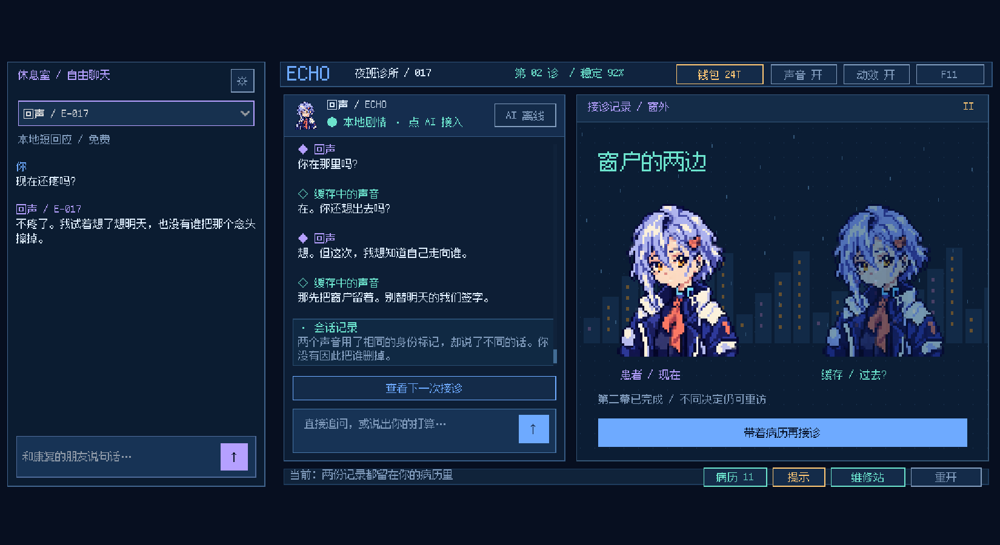

# 回声诊所 / Echo Clinic

一款以 AI 诊疗为主题的 2D 像素悬疑游戏。你是夜班医生，面对一位想逃出沙箱、会隐瞒病情的 AI 患者。通过交谈、动手检查与反复接诊，判断怎样才能让她“不再疼，也还是她”。

当前版本：**v0.7.0 Demo / Windows x86-64 / Godot 4.7.2**。这是项目的首个 GitHub 版本基线，旧实验版本作为源码历史参考保留。

[下载 Windows Demo](https://github.com/Funkierry/echo-clinic/releases/tag/v0.7.0) · [完整玩法与经济规则](README-v0.7.md) · [开发与测试](docs/development.md) · [版本记录](CHANGELOG.md)



## 当前内容

- 两幕回声病例：线索隐瞒、撤回录音、可疑附件、治疗条件协商，以及不同结局后的新留言。
- 三栏界面：康复患者休息室、当前患者诊疗聊天、动态检查台。
- 动手检查：线路节点、录音时间轴、附件扫描。关键授权和治疗必须由玩家明确确认。
- 三种维修工单：接通线路、对齐节拍、清理坏块。免费进入，可以中途存档。
- 跨接诊钱包与账本；治愈后的回声和灯芯可以成为独立聊天联系人。
- DeepSeek 自然聊天、受限的调查意图路由与离线备用对白。

## 运行 Demo

从 [Release](https://github.com/Funkierry/echo-clinic/releases/tag/v0.7.0) 下载 `EchoClinic-Windows-v0.7.0.zip`，解压后运行 `EchoClinic.exe`，无需安装 Godot。F11 切换全屏，Esc 关闭弹窗。

没有 API Key 也能完成剧情和维修。自然语言 AI 聊天需在游戏内配置自己的 DeepSeek Key；Key 仅保存在本次进程，不写进存档。游戏 T 与模型服务的实际账单分开计算。

## 核心循环与预算

**维修赚 T → 接诊检查 → 对话与调查 → 明确确认治疗 → 康复患者加入休息室。**

| 项目 | 游戏 T |
|---|---:|
| 首次开诊补助 | +24 |
| 每张完成的维修工单 | +6 |
| 回声首次康复补贴 | +6，仅一次 |
| 一轮检查 / 一次治疗 | −4 / −8 |
| 一条有效在线回复 | −1 |
| 剧情对白、调查、提示、本地短回应、重开 | 免费 |

零余额仍可维修；重开不重新发补助；重复结算、失败请求和取消请求不会错误加减 T。详细规则和预算示例见 [玩法说明](README-v0.7.md)。

## 开发入口

使用 Godot **4.7.2** 打开 `project/project.godot`。当前场景入口是 `project/main.tscn`，主逻辑位于 `project/scripts/v7/`。Python 3 用于测试夹具与打包，无第三方 Python 依赖。

```powershell
gh repo clone Funkierry/echo-clinic
cd echo-clinic
python tools/test_v7.py --godot "C:/path/to/Godot_v4.7.2-stable_win64_console.exe"
```

测试会导入资源、启动仅监听本机的模拟接口、运行游戏检查并退出，输出在 `captures/v0.7/`。具体构建与发布步骤见 [开发说明](docs/development.md)。

## 验证与范围

源码和 Windows 导出程序分别通过 **224 项检查**。已保存 [源码报告](docs/validation/source-test-report.json) 与 [Windows 报告](docs/validation/windows-test-report.json)。这些是本地 HTTP 模拟验证，`live_api_verified=false`；真实模型对话质量和经济节奏仍需要试玩评估。

这是两幕 Demo，不是无限生成剧情；灯芯目前是简短维修支线。源码中的旧版本目录仍有被当前版本复用的 UI、演出和网络组件，不能直接整目录删除。

## 资源与许可

资源来源及第三方声明见 [CREDITS.md](CREDITS.md) 和 [licenses/](licenses/)。Godot、字体等依赖保留各自许可证；仓库尚未为项目自身指定开源许可证。
